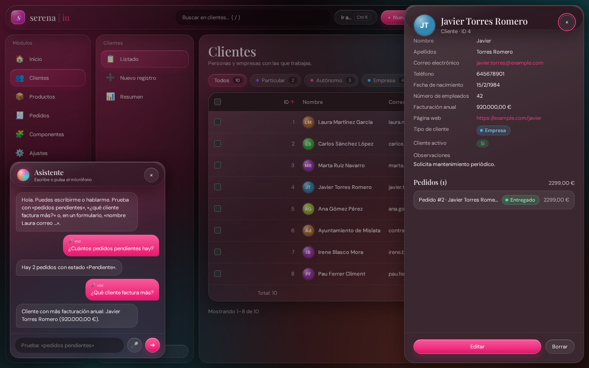
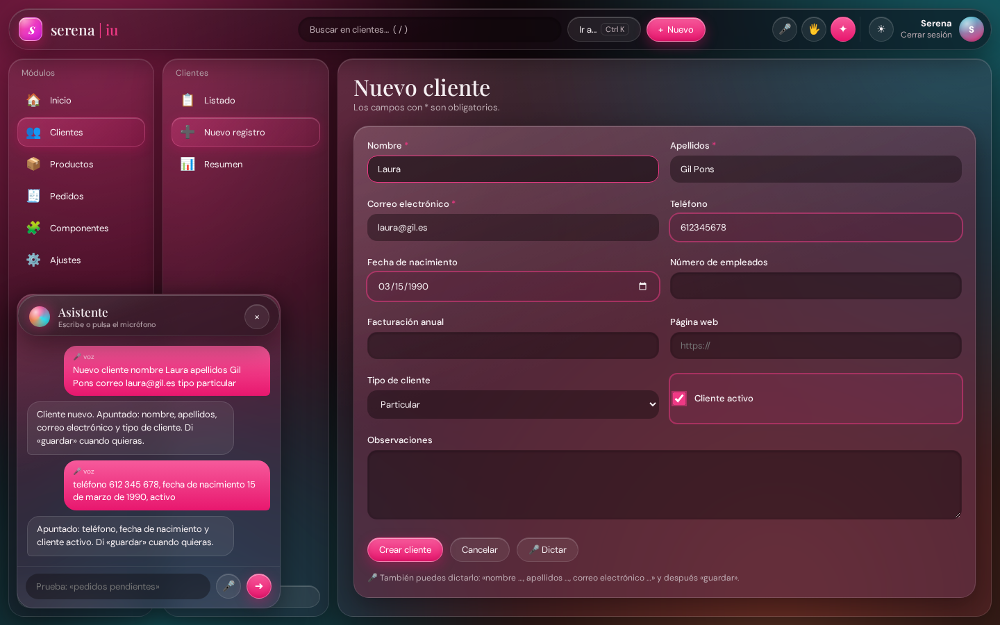
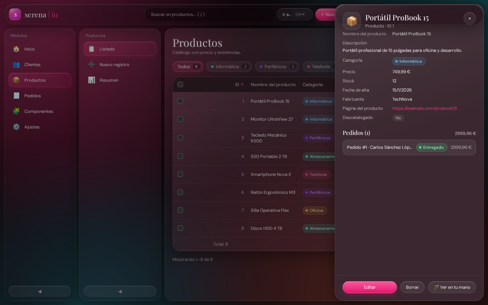
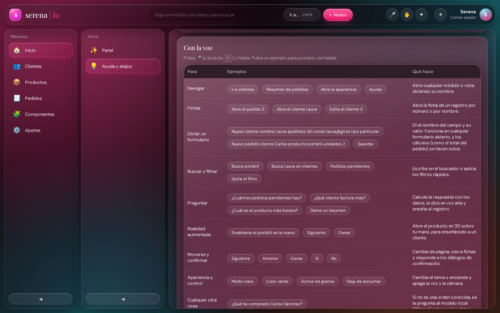
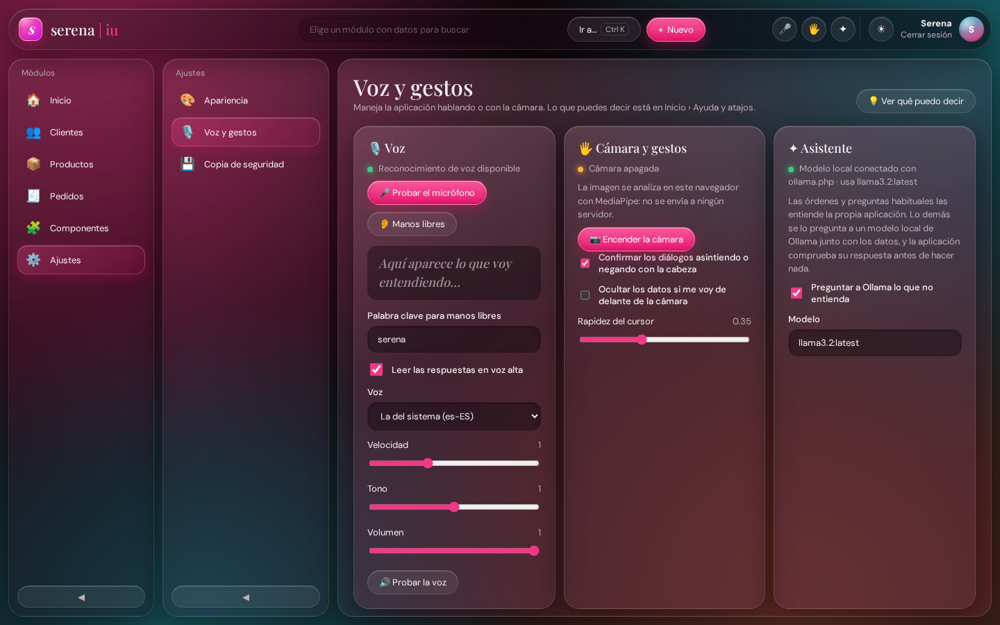

# serena | iu · interfaces naturales

**Módulo:** 0488 · Desarrollo de interfaces
**Actividad:** extender jocarsa | iu con interfaces naturales · RA2
**Resultado de aprendizaje 2:** Genera interfaces naturales de usuario utilizando herramientas visuales.
**Alumna:** Serena Sania Esteve · DAM · TAME Formación

---

## 1. Punto de partida y objetivo

En el RA1 convertí jocarsa | iu en **serena | iu**, una aplicación de gestión de clientes, productos y pedidos que se genera sola a partir de esquemas JSON.

En la unidad 2 hemos visto en clase ejemplos sueltos de interfaces naturales: el chatbot con Ollama, la voz, la detección de manos y cara con MediaPipe y las escenas de A-Frame. El objetivo de esta actividad ha sido **integrarlos en mi aplicación de forma que tengan sentido para quien la usa**, y no como demostraciones aparte. La pregunta que me he hecho con cada función ha sido: *¿para qué le sirve esto a alguien que gestiona clientes y pedidos?*

| Necesidad real | Interfaz natural que la resuelve |
|---|---|
| Dar de alta clientes y pedidos sin teclear (por teléfono, en el almacén…) | **Dictar el formulario**: «nuevo pedido cliente Carlos producto portátil unidades 2» |
| Consultar algo rápido sin buscarlo | **Preguntar en voz alta**: «¿cuántos pedidos pendientes hay?», «¿qué cliente factura más?» |
| Enterarse de cómo va el día sin mirar la pantalla | **«🔊 Escuchar resumen»** en el panel de inicio |
| Moverse por los listados con las manos ocupadas o a distancia | **Gestos**: cursor con la mano, pellizco para hacer clic, deslizar para pasar página |
| Confirmar acciones peligrosas (borrar) sin tocar nada | **Asentir o negar con la cabeza**, o decir «sí» o «no» |
| No dejar datos de clientes a la vista si te levantas | **Modo privacidad**: si no hay nadie delante de la cámara, los datos se difuminan |
| Enseñar un producto a un cliente | **Realidad aumentada** desde la ficha del producto: «🪄 Ver en tu mano» |

Por eso no hay un módulo de «interfaces naturales». Cada función está donde se usa:

| Dónde | Qué hay |
|---|---|
| **Cabecera** (todas las pantallas) | 🎤 hablar · 🖐️ gestos · ✦ asistente (teclas `V`, `G`, `A`) |
| **Formularios** de clientes, productos y pedidos | Botón **🎤 Dictar** y una pista con los campos de ese formulario |
| **Ficha de un producto** y **listado de productos** | Botón **🪄 Ver en tu mano** |
| **Inicio › Panel** | **🔊 Escuchar resumen** |
| **Inicio › Ayuda y atajos** | Atajos de teclado, comandos de voz (con ejemplos que se pueden pulsar) y gestos |
| **Ajustes › Voz y gestos** | Configuración y estado de cada servicio (micrófono, cámara, modelo local) |
| **Diálogos de confirmación** | Se contestan con la voz, con la cabeza o con 👍 |

**Arquitectura.** Todo lo nuevo está en `js/natural.js`, como una capa encima de la aplicación:

```
  🎤 Voz ─────┐
  ⌨️ Texto ───┼─▶ InterpreteIU ──▶ orden { accion, … } ──┐
              │      │  └─▶ DictadoIU (si hay un formulario abierto)
              │      └──▶ OllamaIU (si no entiende la frase)│
  📷 Cámara ──▶ VisionIU (MediaPipe) ─┬─▶ GestosIU ────────┤
                                      ├─▶ CabezaIU ────────┤
                                      └─▶ RealidadAumentadaIU
                                                           ▼
                                            NaturalIU.ejecutar(orden)
                                                           │
           la aplicación de siempre: Enrutador, TablaIU, FormularioIU, PanelDetalleIU, TemaIU…
```

Todas las entradas acaban llamando a las **mismas clases que usan el ratón y el teclado**. «Abre el cliente Laura» abre la misma ficha que un clic en su fila, y un formulario dictado pasa por la misma validación que uno escrito.

**Archivos nuevos o modificados**

| Archivo | Qué contiene |
|---|---|
| `js/natural.js` | **Nuevo.** La capa natural: 14 clases en el namespace `serena.iu` |
| `data/natural.json` | **Nuevo.** Comandos de voz y gestos. La página de ayuda se genera a partir de él |
| `ollama.php` | **Nuevo.** El puente con Ollama de clase, ampliado (modelo, instrucciones de sistema y respuesta en JSON) |
| `data/productos.json` | `"realidadAumentada": true`: el esquema decide qué entidades se pueden ver en AR |
| `data/vistas.json` | Ajustes › Voz y gestos; «Atajos de teclado» pasa a ser «Ayuda y atajos» |
| `index.html` | Botones de la cabecera y plantillas del asistente, la cámara y la capa de AR |
| `css/estilo.css` | Sección 14: mismo estilo «gota de agua» para todo lo nuevo |
| `js/aplicacion.js` | Pequeños enganches (una línea cada uno) en el formulario, la ficha, el listado, el panel, la ayuda, los ajustes y la paleta |

---

## a) Herramientas de aprendizaje automático para interfaces de usuario

Antes de programar he comparado las herramientas disponibles:

| Herramienta | Tipo | Dónde se ejecuta | Para qué sirve | ¿La uso? |
|---|---|---|---|---|
| **MediaPipe Tasks Vision** | Visión por computador | Local, WebAssembly en el navegador | 21 puntos de la mano, cara, cuerpo entero | ✅ Manos y cara |
| **Web Speech API** | Voz | Navegador (Chrome reconoce la voz con un servicio de Google) | Voz a texto y texto a voz | ✅ |
| **Ollama** | Modelo de lenguaje (LLM) | Local, servidor en `localhost:11434` | Entender frases libres y responder preguntas | ✅ |
| **A-Frame** | 3D y realidad aumentada | Navegador, sobre three.js | Escenas 3D con etiquetas HTML | ✅ |
| TensorFlow.js | Aprendizaje automático general | Navegador | Modelos propios o preentrenados (MoveNet, COCO-SSD) | Analizada |
| ml5.js | Capa sencilla sobre TensorFlow.js | Navegador | Clasificar imágenes y poses con poco código | Analizada |
| Teachable Machine | Entrenamiento sin código | Web, exporta a TF.js | Entrenar gestos o sonidos propios | Analizada |
| OpenCV + mediapipe (Python) | Visión por computador | Local, Python | Lo mismo que MediaPipe en aplicaciones de escritorio | Analizada |
| Whisper | Voz a texto | Local o API | Transcribir sin depender del navegador | Analizada |
| APIs de OpenAI, Claude o Gemini | LLM remoto | Nube, de pago y con clave | Asistentes más potentes que un modelo local | Analizada |
| AR.js / MindAR | Realidad aumentada con marcadores | Navegador | Colocar objetos sobre un marcador impreso | Analizada |
| WebXR Device API | Realidad aumentada nativa | Móviles y gafas compatibles | Anclar objetos al suelo o a una mesa | Analizada |

**Por qué he elegido estas cuatro**

- **Todo se ejecuta en el equipo del usuario.** La imagen de la cámara no sale del navegador y el modelo de lenguaje es local, así que no hay coste ni datos de clientes enviados a terceros. Es importante en una aplicación de gestión.
- **Son las que hemos usado en clase**, así que el proyecto conecta directamente con los ejemplos de la unidad (`002-manos.html`, `001-chabotollama.html`, `001-aframe.html`…).
- **No necesitan instalación**, salvo Ollama. MediaPipe y A-Frame se descargan **solo cuando el usuario enciende la cámara o abre un producto en AR**.

En **Ajustes › Voz y gestos** se ve el estado de cada una en ese momento: si el navegador reconoce la voz, si la cámara está encendida y si el modelo local responde (y cuál se está usando).

**Lo que he aprendido comparándolas: reglas propias + modelo de lenguaje**

Al principio quería que Ollama interpretara todas las frases. Probándolo con un modelo pequeño (llama3.2, de 3B) vi dos problemas:

1. **Es lento** (varios segundos por frase en un portátil) para órdenes sencillas como «siguiente».
2. **Se equivoca con los cálculos.** A la pregunta «¿cuál es el producto más caro?» contestó que el Smartphone (499 €), cuando es el Portátil (749,99 €).

Por eso el asistente funciona en dos niveles:

| Nivel | Qué entiende | Ventaja |
|---|---|---|
| **1. Intérprete propio** (`InterpreteIU` y `DictadoIU`) | Órdenes, dictado de formularios y preguntas habituales (contar, máximos, mínimos, totales) | Instantáneo, exacto y funciona sin conexión |
| **2. Ollama** | Todo lo demás: «¿qué ha comprado Carlos Sánchez?» | Entiende frases que no he previsto |

Además, **lo que propone el modelo nunca se ejecuta tal cual**: tiene que contestar con un JSON (`"format": "json"` de Ollama) y `InterpreteIU.validar()` comprueba que el módulo, la vista o el registro existen antes de hacer nada.

---

## b) Interfaz natural creada con las herramientas

La interfaz natural no es una pantalla nueva, sino una forma más de usar las que ya existían:

- **Botones 🎤 🖐️ ✦ en la cabecera** y teclas `V`, `G` y `A`. También están en la paleta de comandos (`Ctrl + K`).
- **Asistente flotante**: la conversación con la aplicación, por texto o por voz. Su «gota» de colores late al escuchar, gira al pensar y vibra al hablar.
- **Ventana de la cámara**: miniatura espejada con el esqueleto de la mano y el último gesto reconocido.
- **Cursor de la mano**: una gota con un anillo que se va llenando al mantener un gesto.
- **Botones en el sitio donde se usan**: «🎤 Dictar» en los formularios, «🪄 Ver en tu mano» en los productos, «🔊 Escuchar resumen» en el panel.
- **Ayuda** (Inicio › Ayuda y atajos): se genera desde `data/natural.json` y cada ejemplo se puede pulsar para probarlo.
- **Ajustes › Voz y gestos**: voz, velocidad, tono y volumen, palabra clave, opciones de la cámara y modelo de IA.

Todo usa las mismas variables CSS que el resto de la app, así que cambia con el tono y con el modo claro u oscuro.



---

## c) Reconocimiento de voz para implementar acciones

Se usa la **Web Speech API**, igual que en `003-Voz y Habla`, pero conectada con la aplicación.

**Escucha (`VozIU`)**

- **Una frase**: botón 🎤 o tecla `V`. Escucha hasta que te callas.
- **Manos libres**: escucha todo el rato (`continuous = true`), pero **solo obedece las frases que empiezan por la palabra clave** («Serena, pedidos pendientes»). Así no reacciona a una conversación con un compañero.
- **Resultados provisionales** (`interimResults = true`): lo que va entendiendo se ve en directo.
- Chrome corta la escucha continua cada cierto tiempo. Cuando pasa, `onend` la vuelve a arrancar.
- **Mientras habla, no escucha.** Si no, en manos libres la aplicación se oiría a sí misma y se daría órdenes.

**Dictar formularios (`DictadoIU`).** Es la función de voz más útil para una aplicación de gestión. Con un formulario abierto se dice el nombre del campo y su valor:

> «Nuevo cliente **nombre** Laura **apellidos** Gil Pons **correo** laura@gil.es **tipo** particular»
> «**teléfono** 612 345 678, **fecha de nacimiento** 15 de marzo de 1990, **facturación** 42.000, **activo**»
> «Guardar»

- **Los nombres de los campos salen del esquema JSON**: la etiqueta («Correo electrónico»), el nombre técnico («email»), una palabra corta («correo») y algunos sinónimos. Por eso **cualquier formulario se puede dictar**, incluidos los de módulos que se añadan después.
- **Cada tipo de campo se convierte**: «15 de marzo de 1990» → `1990-03-15`, «42.000» → `42000`, «laura arroba gil punto es» → `laura@gil.es`, «particular» → la opción *Particular* del desplegable, «Carlos» → *Carlos Sánchez López* de la lista de clientes, «activo» o «no activo» → la casilla.
- El valor se escribe **lanzando los mismos eventos que el teclado** (`input` y `change`). Así funcionan la validación, el aviso de cambios sin guardar y los cálculos: al dictar el producto y las unidades de un pedido, **el total se calcula solo**.
- El asistente contesta qué ha apuntado y qué falta: *«Apuntado: nombre, apellidos, correo electrónico y tipo de cliente. Di «guardar» cuando quieras.»*
- Para no confundir órdenes con dictado, la frase tiene que **empezar** por un campo: «abre el cliente 3» no rellena el campo *Cliente* de un pedido.



**Otras órdenes** (la lista completa está en Inicio › Ayuda y atajos)

| Para | Ejemplos |
|---|---|
| Navegar | «Ir a clientes», «Resumen de pedidos», «Ayuda» |
| Fichas | «Abre el pedido 3», «Abre el cliente Laura», «Edita el cliente 3» |
| Buscar y filtrar | «Busca portátil», «Pedidos pendientes», «Quita el filtro» |
| Preguntar | «¿Cuántos pedidos pendientes hay?», «¿Qué cliente factura más?», «Dame un resumen» |
| Moverse y confirmar | «Siguiente», «Cerrar», «Guardar», «Sí», «No» |
| Realidad aumentada | «Enséñame el portátil en la mano», «Siguiente», «Cerrar» |
| Cualquier otra cosa | «¿Qué ha comprado Carlos Sánchez?» → Ollama con los datos |

Las respuestas se **leen en voz alta** con `SpeechSynthesisUtterance`. En Ajustes se elige la voz, la velocidad, el tono y el volumen.

**Cuidado con los cambios sin guardar.** Si dices «abre el cliente 3» con un formulario a medias, la aplicación pregunta antes de salir, igual que con el ratón. La ficha solo se abre si contestas «sí».

---

## d) Detección del movimiento del cuerpo para implementar acciones

Aquí no basta con saber dónde está una parte del cuerpo: hay que seguir **cómo se mueve a lo largo del tiempo**. Para eso guardo un pequeño historial de posiciones.

| Movimiento | Cómo se detecta | Para qué sirve |
|---|---|---|
| 👋 **Deslizar la mano** | Con la palma abierta, la muñeca recorre más del 28 % del ancho de la imagen en menos de 0,45 s, casi en horizontal | Pasar página en un listado |
| ↕️ **Pellizcar y arrastrar** | Mientras dura el pellizco, el cursor se desplaza más de 28 px en vertical | Desplazar la tabla, como con el dedo en un móvil |
| 🙆 **Asentir** | El centro de la cara oscila en vertical (amplitud > 12 % del alto de la cara y al menos dos cambios de sentido en 1,4 s) | «Sí» al diálogo abierto, por ejemplo **confirmar un borrado** |
| 🙅 **Negar** | Lo mismo en horizontal | «No» al diálogo abierto |
| 🙈 **Irse de delante de la cámara** | No hay ninguna cara durante 2,5 s | **Modo privacidad**: los datos de clientes se difuminan hasta que vuelves |

Los cambios de sentido se cuentan ignorando los temblores pequeños:

```js
static vaivenes(valores, minimo) {
	let cambios = 0, sentido = 0, ancla = valores[0];
	valores.forEach((valor) => {
		const diferencia = valor - ancla;
		if (Math.abs(diferencia) < minimo) { return; }   // temblor: no cuenta
		const nuevo = Math.sign(diferencia);
		if (sentido && nuevo !== sentido) { cambios++; }
		sentido = nuevo;
		ancla = valor;
	});
	return cambios;
}
```

Para evitar falsos positivos, la cabeza **solo se interpreta mientras hay un diálogo abierto**, y no hasta pasados 0,7 s, porque al aparecer el diálogo es normal mover la cabeza para leerlo. Después de cada gesto hay una pausa de 1,5 s para que no se repita.

---

## e) Detección de partes del cuerpo para implementar acciones

Se usan dos modelos de **MediaPipe Tasks Vision** en un único bucle (`VisionIU`): el de manos en cada fotograma y el de cara uno de cada tres, porque para asentir basta y así se ahorra CPU.

- **HandLandmarker**: 21 puntos de la mano (muñeca, nudillos, articulaciones y puntas de los dedos), como en `002-manos.html`.
- **FaceDetector**: el rectángulo de la cara, como en los ejemplos de A-Frame.

Con los puntos de la mano, `ManoIU` calcula qué dedos están estirados. Todas las medidas se dividen por el tamaño de la palma (muñeca → nudillo del corazón), así que **funcionan igual con la mano cerca o lejos de la cámara**:

```js
get palma() { return this.distancia(0, 9); }

/** Un dedo está estirado si su punta queda más lejos de la muñeca que su articulación del medio */
estirado(punta, articulacion) {
	return this.distancia(0, punta) > this.distancia(0, articulacion) * 1.12;
}

/** Separación entre las puntas de índice y pulgar, relativa al tamaño de la mano */
get pinza() { return this.distancia(4, 8) / this.palma; }
```

| Gesto | Partes del cuerpo | Acción en la aplicación |
|---|---|---|
| ☝️ **Apuntar** | Puntas del índice (8) y del pulgar (4) | Mueve un cursor por toda la pantalla |
| 🤏 **Pellizco** | Índice + pulgar juntos (< 0,3 palmas) | Clic: abrir una ficha, pulsar un botón, elegir un filtro… |
| ✋ **Palma abierta y quieta 1 s** | Los cinco dedos | Cierra la ficha o el diálogo, o vuelve al listado (como `Escape`) |
| 👍 **Pulgar arriba 0,7 s** | Solo el pulgar, hacia arriba | Acepta el diálogo o **guarda el formulario** |

**Detalles para que se pueda usar de verdad**

- **El cursor es el punto medio entre índice y pulgar**, no la punta del índice. Así no se mueve al pellizcar y el clic cae donde estabas apuntando.
- **Solo se usa la parte central de la imagen** (60 % del ancho): para llegar al borde de la pantalla no hay que sacar la mano de la cámara.
- **Suavizado** (como en `005-con suavizado.html`), ajustable en Ajustes.
- **Dos umbrales para el pellizco** (entra por debajo de 0,30 y sale por encima de 0,45). Con uno solo, el clic se repetía cuando la mano temblaba justo en el límite.
- El cursor es un elemento `popover`, que vive en la capa superior del navegador. Así también funciona **sobre los diálogos modales**: un «¿Borrar este cliente?» se puede contestar con la mano.
- El elemento que hay bajo el cursor se resalta, como el `:hover` del ratón.

> 📸 *Captura propia: ventana de la cámara con el esqueleto de la mano y el cursor sobre la tabla.*

---

## f) Realidad aumentada integrada en la interfaz

**Para qué.** En una tienda o en una visita comercial, el vendedor puede abrir la ficha de un producto y enseñárselo al cliente **en 3D sobre su propia mano**, con el precio y el stock reales.

**Dónde.** El botón **🪄 Ver en tu mano** aparece en la ficha de cada producto y en el listado de productos. También se puede decir «enséñame el portátil en la mano». El botón no está escrito para productos en concreto: aparece en cualquier entidad cuyo esquema tenga `"realidadAumentada": true`.



**Cómo se ve.** Se abre una capa a pantalla completa:

- La **webcam es el fondo** (espejada, como un espejo).
- Encima hay una **escena de A-Frame transparente** (`renderer="alpha: true"`) con una caja que gira, un aro y una etiqueta flotante con el nombre, la categoría, el precio y el stock (en rojo si quedan menos de 5).
- Los datos salen de `productos.json`, igual que en la tabla: si cambio un precio en el formulario, también cambia en 3D.

**Cómo se ancla el objeto a la mano.** En cada fotograma:

1. MediaPipe da los puntos de la mano en coordenadas de la imagen (0–1).
2. Se pasan a píxeles teniendo en cuenta que el vídeo está **espejado** y **recortado** con `object-fit: cover`.
3. Se pasan a coordenadas 3D: a una distancia `d` de la cámara, con un campo de visión `fov`, lo que se ve mide `2·d·tan(fov/2)` de alto. Con eso, el centro de la palma se convierte en la posición `x, y` del objeto.
4. El **tamaño** del objeto es proporcional al de la palma (si acercas la mano, crece) y su **inclinación** sigue la línea muñeca → nudillo.
5. Todo se suaviza para que no tiemble.

```js
const mitadAlto = DISTANCIA * Math.tan((FOV / 2) * Math.PI / 180);
const mitadAncho = mitadAlto * (ancho / alto);
const objetivo = {
	x: (centro.x / ancho * 2 - 1) * mitadAncho,
	y: (1 - centro.y / alto * 2) * mitadAlto,
	tamano: (palma / alto) * 2 * mitadAlto * 2.4,
	giro: Math.atan2(nudillo.x - muneca.x, muneca.y - nudillo.y)
};
```

**Interacción**

| | Acción |
|---|---|
| ✋ Mano abierta | El producto aparece y la sigue |
| 🤏 Pellizco · flechas · «siguiente» | Otro producto del catálogo |
| ✊ Puño | «Guardas» el producto (se esconde) |
| 🎤 «Muestra el ratón» | Salta a ese producto |
| 📸 Captura | Descarga una foto con la imagen real y el objeto 3D juntos |
| × · `Escape` · «cerrar» | Vuelve a la aplicación |

**Decisiones técnicas**

- Si la cámara está apagada, se enciende sola al abrir la AR. Es la misma cámara que la de los gestos: no se abre dos veces.
- Las caras de la caja y la etiqueta se dibujan en un `<canvas>` 2D que se usa como textura, porque las fuentes que trae `a-text` de A-Frame no muestran bien las tildes ni los emojis.
- Para la captura, la escena se vuelve a dibujar justo antes de copiarla, porque WebGL borra el lienzo después de cada fotograma.
- Al cerrar se elimina la escena y se libera el contexto WebGL (`forceContextLoss`), porque el navegador solo permite unos pocos a la vez. Mientras está abierta, la mano sostiene el producto y no mueve el cursor.

> 📸 *Captura propia: producto en 3D sobre la palma (botón «📸 Captura» de la propia capa).*

---

## Ayuda y ajustes





---

## Cómo ejecutarla

```bash
cd serena-iu
php -S localhost:8000
```

Después hay que abrir `http://localhost:8000` en **Chrome o Edge** (Firefox no tiene reconocimiento de voz). Cuenta de prueba: `demo@serena.iu` / `demo1234`.

- **Cámara y micrófono**: el navegador pide permiso la primera vez. Solo funcionan en `localhost` o con `https`.
- **Ollama** (opcional, para las preguntas libres): `ollama serve` y un modelo instalado, por ejemplo `ollama pull phi3:mini`. Si el modelo elegido no está, se usa otro de los instalados. Sin Ollama, todo lo demás funciona igual.
- Con `python3 -m http.server 8000` también funciona: si no hay PHP, la aplicación se conecta directamente a Ollama en `localhost:11434`.

## Pruebas realizadas

He probado los flujos completos en Chromium, con una cámara simulada y escribiendo en el asistente las frases que devolvería el reconocimiento de voz:

- **Dictar un cliente** en dos frases (nombre, apellidos, correo, tipo, teléfono, fecha, facturación y activo) y **guardarlo**: el cliente aparece en el listado.
- **Dictar un pedido**: el cliente y el producto se eligen de sus listas, las unidades se apuntan y **el total se calcula solo** (2 × 749,99 = 1.499,98 €).
- Decir «abre el cliente 3» con el pedido a medias: aparece el aviso de cambios sin guardar y la ficha solo se abre después de decir «sí».
- **Borrar un cliente** contestando «sí» al diálogo de confirmación.
- **Realidad aumentada** desde la ficha de un producto, por voz («enséñame el portátil en la mano») y desde el listado. «Siguiente» y «muestra el ratón» cambian el producto. Al cerrar, la escena se elimina y los gestos vuelven a funcionar.
- MediaPipe se carga y analiza la imagen. Con una mano simulada, la postura se reconoce como «palma», el pellizco hace clic y el objeto 3D se coloca sobre la mano.
- Preguntas, búsquedas, filtros, tema y paginación por voz. **Ollama** responde a las preguntas libres y su acción se valida antes de ejecutarla.
- Sin errores en la consola. En el móvil no hay desplazamiento horizontal.

## Limitaciones y mejoras posibles

- El reconocimiento de voz de Chrome **necesita conexión**: envía el audio a un servicio de Google. Para que funcione sin internet se podría usar **Whisper** en local.
- Un modelo pequeño se equivoca a veces en las preguntas libres. Por eso las preguntas de cálculo las resuelve el intérprete propio.
- La realidad aumentada sigue la mano, pero no detecta superficies. Para dejar un producto encima de la mesa habría que usar **WebXR** en un móvil compatible.
- Con **Teachable Machine** se podrían entrenar gestos propios, por ejemplo uno para cada módulo.

---

## Conclusión

La primera versión que hice tenía todas las interfaces naturales juntas en un módulo aparte, como una colección de demostraciones. Funcionaban, pero no servían para nada dentro de la aplicación. Al reorganizarlas me di cuenta de que **una interfaz natural tiene sentido cuando sustituye a una tarea concreta**: dictar en lugar de teclear un formulario, preguntar en lugar de buscar, asentir en lugar de pulsar «Aceptar» o enseñar un producto en lugar de describirlo.

Gracias a que en el RA1 la aplicación ya estaba organizada en clases y generada desde JSON, la voz, los gestos y la IA solo tienen que traducir lo que hace el usuario a una orden y llamar a las mismas funciones que el ratón. Por eso el dictado sirve para cualquier formulario, el botón de AR lo activa el esquema y la ayuda se genera desde un JSON.

También he aprendido que **la IA no siempre es la mejor herramienta**: para órdenes habituales y cálculos es más rápido y fiable un intérprete propio, y el modelo de lenguaje es útil para lo que no se ha previsto, siempre que se valide lo que propone.
