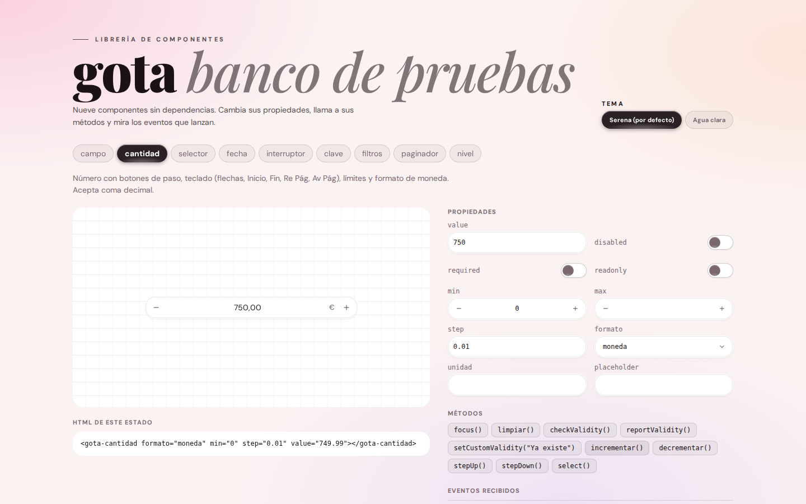
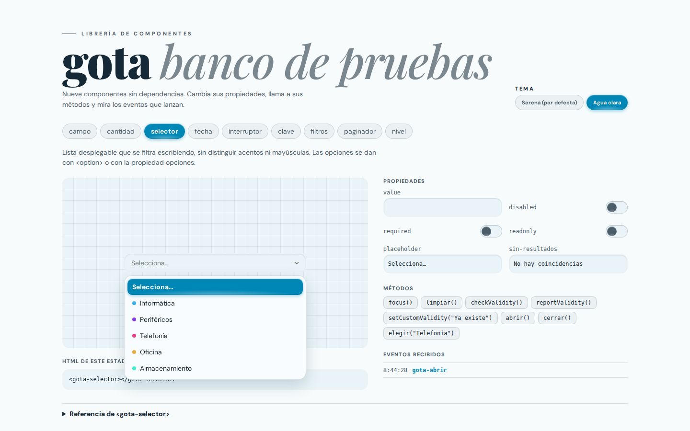
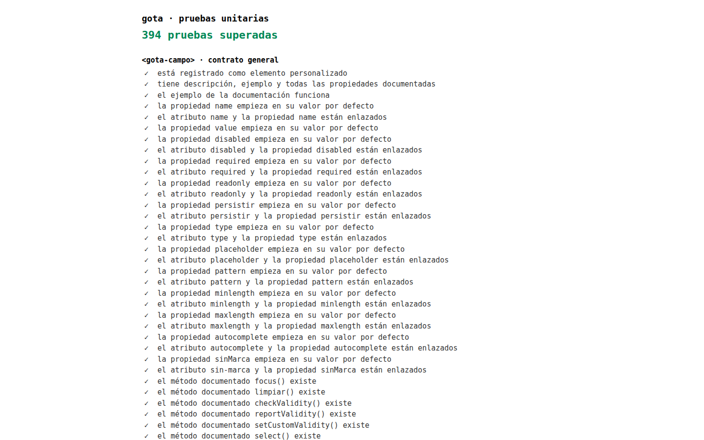
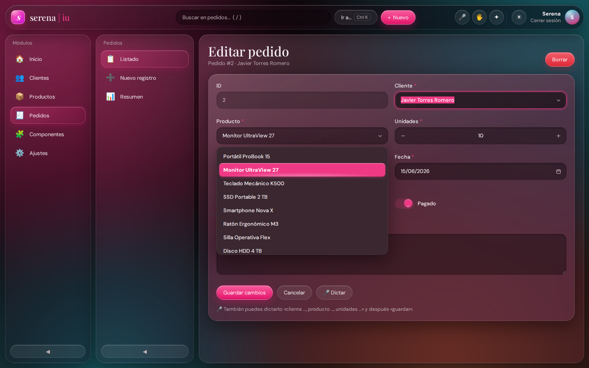
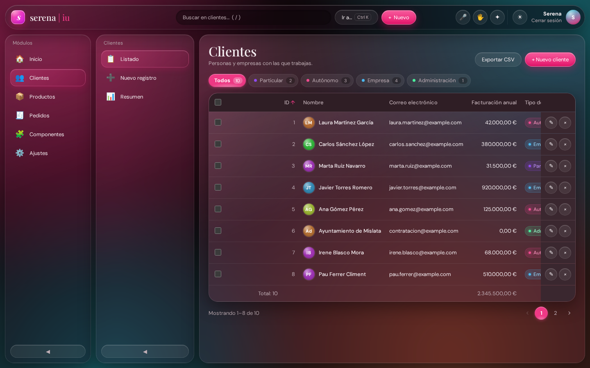
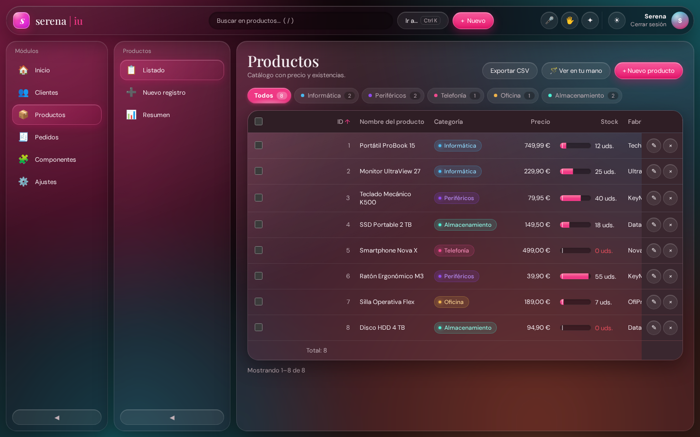
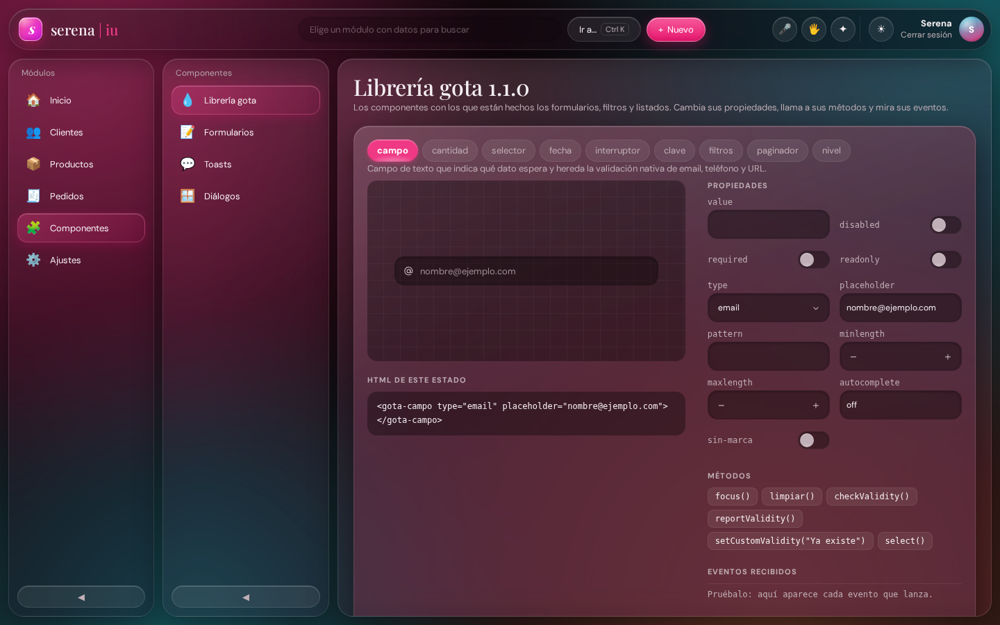
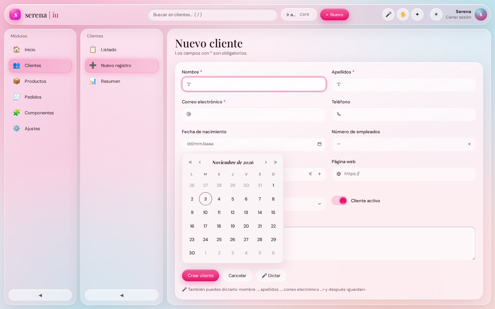
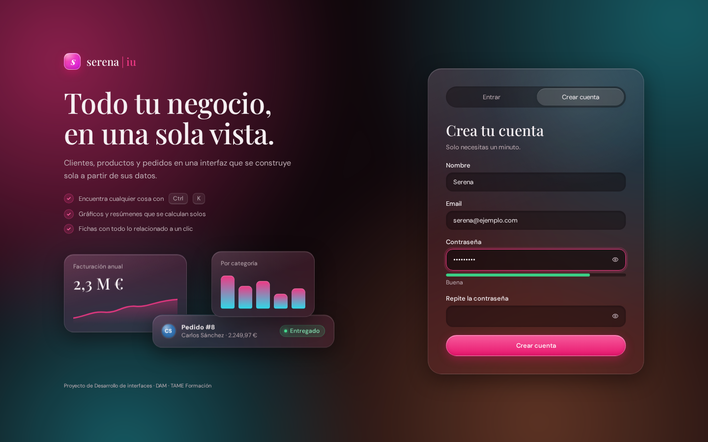

# gota · librería de componentes visuales

**Módulo:** 0488 · Desarrollo de interfaces
**Actividad:** crea tu propia librería de componentes visuales e intégralos con tu interfaz de usuario · RA3
**Resultado de aprendizaje 3:** Crea componentes visuales valorando y empleando herramientas específicas.
**Alumna:** Serena Sania Esteve · DAM · TAME Formación

---

## 1. Punto de partida y objetivo

En el RA1 y el RA2, los formularios y listados de **serena | iu** usaban los controles nativos del navegador (`<input>`, `<select>`, `<input type="date">`, casillas) más algunos hechos a mano dentro de la aplicación (los filtros rápidos, la paginación y el medidor de la contraseña). Funcionaban, pero:

- cada navegador los dibuja a su manera, sobre todo el calendario y el desplegable;
- no se pueden adaptar al estilo de la aplicación (un `<select>` no admite colores por opción);
- los controles hechos a mano estaban mezclados con el código de la app y no se podían reutilizar.

El objetivo ha sido crear **gota**, una librería de componentes propia, independiente de serena | iu, y después **sustituir con ella los controles de la aplicación**.

**La idea visual.** En toda la librería, la selección es **una gota que se mueve**: al elegir otra opción no cambia un color, la gota viaja hasta ella, se estira por el camino y recupera la forma al llegar. Es la misma gota en el interruptor, los filtros, el paginador, el selector y el calendario, y le da nombre a la librería.

**El estilo.** El tema por defecto es el de mi portafolio (serenaesteve.com): ciruela casi negro sobre rosa empolvado, DM Sans para el texto, Playfair Display en cursiva para los títulos y modo oscuro invertido. Dentro de serena | iu, los componentes toman los colores de la aplicación.

| | Dónde está |
|---|---|
| Código de la librería | carpeta `gota/` de este repositorio (`src/`, `pruebas/`, `banco/`, `docs/`), independiente de la app |
| Paquete | `gota/dist/gota-1.2.0.tgz` |
| Instalada en la aplicación | `serena-iu/lib/gota/` (el contenido del paquete, como lo dejaría npm) |

---

## a) Herramientas para diseño y prueba de componentes

| Para | Herramientas analizadas | Elegida | Por qué |
|---|---|---|---|
| **Crear los componentes** | React, Vue, Lit, Stencil, **Web Components estándar** | Web Components estándar (Custom Elements, Shadow DOM, ElementInternals) | Funcionan en cualquier página, con o sin framework, y no tienen dependencias. serena | iu no usa ningún framework, y una librería en React me habría obligado a reescribir la app |
| **Diseñarlos y verlos aislados** | Figma, **Storybook**, Ladle, Histoire | **Banco de pruebas propio** (`banco/`), al estilo de Storybook | Storybook necesita Node, un bundler y su propia configuración. Mi banco es una página HTML que se genera sola con los datos de cada componente |
| **Inspeccionarlos** | **DevTools de Chrome y Firefox** | Las dos | El panel Elements muestra el `#shadow-root` y las `::part`; el panel Accessibility comprueba los roles y nombres accesibles |
| **Probarlos** | Jest + jsdom, Vitest, Web Test Runner, **Playwright** | **Arnés propio + Playwright** | jsdom no implementa bien Shadow DOM ni ElementInternals, así que las pruebas tienen que ejecutarse en navegadores reales. Playwright los abre sin ventana |
| **Revisar la accesibilidad** | Lighthouse, WAVE, **axe-core**, Pa11y | **axe-core** dentro de mis pruebas | Es el motor que usan Lighthouse y las DevTools, entra en el Shadow DOM y se puede llamar desde una prueba: así la accesibilidad se comprueba en cada ejecución, no solo cuando me acuerdo de mirarla |
| **Documentarlos** | JSDoc, Custom Elements Manifest, Storybook Docs | **Manifiesto propio → `docs/API.md`**, y además el **Custom Elements Manifest** estándar | La documentación se genera a partir de la misma tabla que define el componente, así que no puede quedarse desactualizada. El formato estándar se genera también, para que otras herramientas (Storybook, editores) entiendan la librería |
| **Empaquetarlos** | npm pack, Vite (modo librería), Rollup | **Script propio** `construir.py` | Une los archivos, genera la documentación y crea un `.tgz` con el formato exacto de `npm pack`, sin instalar Node |

**La decisión importante: una sola fuente de verdad.** Cada componente declara su API en una tabla: propiedades con su tipo y su valor por defecto, eventos, métodos y partes. De esa tabla salen:

1. los atributos HTML y las propiedades JavaScript (la clase base los crea solos);
2. los mandos del banco de pruebas;
3. la documentación `docs/API.md`;
4. los tipos de TypeScript, el autocompletado de VS Code y el Custom Elements Manifest;
5. una parte de las pruebas unitarias, que comprueban que cada propiedad empieza en su valor por defecto y que cada método documentado existe.

Así, si añado una propiedad, aparece a la vez en el código, en el banco, en la documentación, en el autocompletado del editor y en las pruebas.



---

## b) Componentes visuales creados

| Componente | Sustituye a | Qué añade |
|---|---|---|
| `<gota-campo>` | `<input>` de texto, email, teléfono y URL | Icono del tipo de dato y validación nativa |
| `<gota-cantidad>` | `<input type="number">` | Botones de paso, coma decimal, formato de moneda y teclado (flechas, Inicio, Fin, Re Pág, Av Pág) |
| `<gota-selector>` | `<select>` | Filtrar escribiendo sin tildes ni mayúsculas; opciones con color |
| `<gota-fecha>` | `<input type="date">` | Calendario propio igual en todos los navegadores, y fecha escrita a mano (15/3/1990) |
| `<gota-interruptor>` | Casilla de verificación | La gota cruza el canal |
| `<gota-clave>` | Envuelve `<input type="password">` | Mostrar y ocultar, y medidor de fuerza |
| `<gota-filtros>` | Grupo de botones | Una sola gota para todo el grupo, con cantidades y colores |
| `<gota-paginador>` | Paginación hecha a mano | Puntos suspensivos en los saltos largos; la gota marca la página actual |
| `<gota-nivel>` | `<meter>` | Líquido en un tubo, marca de mínimo y estados (agotado, bajo, normal, lleno) |

**Cómo están construidos**

- **Clase base `GotaElemento`**: crea el Shadow DOM, aplica los estilos comunes y genera los atributos y las propiedades a partir de la tabla de la API.
- **Clase `GotaControl`** (hereda de la anterior): da a los controles de formulario el mismo contrato que un `<input>` gracias a **ElementInternals**. Aparecen en `form.elements`, se envían con el formulario, se validan (`validity`, `checkValidity()`), vuelven a su valor con `reset()` y se desactivan dentro de un `<fieldset disabled>`.
- **Shadow DOM**: el CSS de la página no los rompe y el suyo no se escapa. Por fuera solo entran las **variables `--gota-*`** (el tema) y las **partes** (`::part(entrada)`, `::part(canal)`, `::part(liquido)`…).
- **Accesibles**: roles ARIA (`switch`, `combobox`, `listbox`, `grid`, `spinbutton`, `meter`…), uso con teclado, el `<label>` de la página les da nombre y respetan `prefers-reduced-motion`.

**La gota** (`movimiento.js`) se mueve con la técnica FLIP: se calcula dónde está y adónde va, se coloca en el destino y se anima la diferencia. Mientras viaja se estira en la dirección del movimiento (`scale(1.22, .74)`), llega un poco aplastada y recupera la forma, como una gota de verdad.

**Temas.** El tema por defecto es el de mi portafolio. El paquete trae un segundo tema, «agua clara» (azul), que se activa poniendo una clase en cualquier contenedor. Sirve para demostrar que todo el aspecto se cambia desde fuera.



---

## c) Métodos y propiedades con valores por defecto

Cada componente declara sus propiedades en una tabla con **tipo**, **valor por defecto** y **descripción**:

```js
class GotaNivel extends GotaElemento {
	static etiqueta = "gota-nivel";
	static propiedades = {
		value:    { tipo: Number,  defecto: 0,       descripcion: "Cantidad actual." },
		max:      { tipo: Number,  defecto: 100,     descripcion: "Cantidad con la que el tubo está lleno." },
		minimo:   { tipo: Number,  defecto: 0,       descripcion: "Por debajo de esta cantidad el estado es «bajo»." },
		unidad:   { tipo: String,  defecto: "",      descripcion: "Unidad junto a la cifra." },
		vertical: { tipo: Boolean, defecto: false,   descripcion: "Tubo de pie, como una probeta." },
		etiqueta: { tipo: String,  defecto: "Nivel", descripcion: "Nombre para los lectores de pantalla." }
	};
	static metodos = { "ajustar(diferencia)": "Suma o resta a la cantidad actual, sin bajar de 0." };
	…
}
```

A partir de esa tabla, la clase base crea para cada propiedad un **getter y un setter** enlazados con su **atributo HTML**. `vertical` se convierte en el atributo `vertical`, `sinCifra` en `sin-cifra`, y el texto del atributo se convierte al tipo declarado. Si el atributo no está, el getter devuelve el **valor por defecto**. Por eso se puede usar de las dos formas:

```html
<gota-nivel value="7" max="60" minimo="10" unidad="uds."></gota-nivel>
```
```js
nivel.max = 60;          // propiedad → actualiza el atributo y repinta
nivel.ajustar(-5);       // método
```

**Ejemplos de valores por defecto**

| Componente | Propiedad | Por defecto |
|---|---|---|
| `gota-campo` | `type` | `"text"` |
| `gota-cantidad` | `step` · `formato` · `moneda` · `locale` | `"1"` · `"numero"` · `"EUR"` · `"es-ES"` |
| `gota-selector` | `placeholder` · `sinResultados` | `"Selecciona…"` · `"No hay coincidencias"` |
| `gota-fecha` | `placeholder` · `locale` | `"dd/mm/aaaa"` · `"es-ES"` |
| `gota-interruptor` | `value` · `checked` | `"on"` · `false` |
| `gota-clave` | `medidor` · `minimo` | `false` · `8` |
| `gota-paginador` | `pagina` · `paginas` · `vecinas` | `1` · `1` · `1` |
| Todos los controles | `disabled` · `required` · `readonly` | `false` |

**Métodos.** Además de los del contrato de formulario (`focus()`, `checkValidity()`, `reportValidity()`, `setCustomValidity()`, `limpiar()`), cada componente tiene los suyos: `incrementar()` y `stepUp()` en la cantidad, `abrir()`, `cerrar()` y `elegir(valor)` en el selector, `irAMes()` y `hoy()` en la fecha, `siguiente()`, `anterior()` e `ir(pagina)` en el paginador, `alternar()` en el interruptor y la clave, y `actualizarCantidades()` en los filtros.

Los valores por defecto del **aspecto** también son propiedades: cada variable `--gota-*` tiene un valor por defecto (el tema de mi portafolio) que la página puede cambiar.

---

## d) Eventos y acciones asociadas

Cada componente escucha los eventos del usuario (puntero, teclado y foco) y los convierte en acciones; después **lanza sus propios eventos** para que la aplicación reaccione.

**Eventos que escuchan**

| Componente | Evento del usuario | Acción |
|---|---|---|
| `gota-cantidad` | Clic en − / + · flechas · Re Pág · Inicio/Fin | Sumar o restar un paso, o diez, o ir al mínimo o al máximo, sin salir de los límites |
| `gota-selector` | Escribir · ↑ ↓ · Enter · Escape | Filtrar, moverse por las opciones, elegir, cerrar |
| `gota-fecha` | Escribir «15/3/1990» · flechas · Inicio/Fin · Re Pág/Av Pág en el calendario | Interpretar la fecha; moverse por días, semanas o meses |
| `gota-interruptor` | Clic · Espacio · Enter | Cambiar de estado (la gota cruza el canal) |
| `gota-filtros`, `gota-paginador` | Clic · Tab y Enter (son botones) | Elegir otro filtro o página; la gota viaja hasta él |
| `gota-clave` | Escribir · clic en el ojo | Recalcular la fuerza · mostrar u ocultar |

**Eventos que lanzan**

| Evento | `detail` | Cuándo |
|---|---|---|
| `input` / `change` | — | Igual que un control nativo: así funcionan con cualquier código ya escrito |
| `gota-cambio` | `{ valor, anterior, origen }` | Cambio con datos. `origen` dice si vino del teclado, del puntero o del código |
| `gota-abrir` / `gota-cerrar` | — | Se abre o se cierra la lista o el calendario |
| `gota-mes` | `{ anio, mes }` | El calendario enseña otro mes |
| `gota-pagina` | `{ pagina, anterior }` | El usuario cambia de página |
| `gota-fuerza` | `{ puntos, texto }` | Cambia la fuerza de la contraseña |
| `gota-visibilidad` | `{ visible }` | Se muestra u oculta la contraseña |
| `gota-umbral` | `{ estado, anterior, valor }` | El nivel pasa a otro estado (por ejemplo, de normal a bajo) |

Todos los eventos propios se lanzan con `bubbles` y `composed`, así que salen del Shadow DOM y se pueden escuchar en el formulario o en el documento.

**Ejemplo en serena | iu.** La paginación de los listados escucha `gota-pagina` y vuelve a pintar la tabla:

```js
paginador.addEventListener("gota-pagina", (evento) => {
	estado.pagina = evento.detail.pagina;
	this.pintar(entidad, contenedor);
});
```

---

## e) Pruebas unitarias

Las pruebas se ejecutan **en navegadores reales**, porque un Web Component necesita un DOM real, Shadow DOM y ElementInternals. El arnés (`pruebas/arnes.js`) es mío y no tiene dependencias: `grupo()`, `prueba()`, `montar(html)` y las afirmaciones `igual`, `parecido`, `cierto` y `falso`. Se puede abrir `pruebas/index.html` en cualquier navegador, o lanzarlas sin ventana:

```bash
python3 pruebas/ejecutar.py chromium firefox   # en los dos navegadores
python3 pruebas/ejecutar.py --paquete          # sobre lo que hay DENTRO del .tgz
```

**429 pruebas, todas superadas en Chromium y en Firefox**, y también sobre el contenido del paquete. Cada navegador repite después las 29 de accesibilidad con el esquema oscuro, porque el contraste cambia con él. Comprobar el paquete es importante: demuestra que lo que se instala funciona, no solo el código fuente.

| Grupo | Qué comprueba |
|---|---|
| **Contrato general** (se genera para los 9 componentes a partir de su tabla) | Está registrado; tiene descripción y ejemplo; el ejemplo de la documentación funciona; **cada propiedad empieza en su valor por defecto**; cada atributo y su propiedad están enlazados en los dos sentidos; cada método documentado existe |
| **En un formulario** (los controles) | Aparece en `form.elements` y se envía con su `name`; `required` marca `valueMissing`; `reset()` vuelve al valor inicial; `disabled` no se envía; `<fieldset disabled>` lo desactiva; el `<label>` le da nombre y foco |
| **Comportamiento** (uno por componente) | Teclado, límites, formato de moneda, filtrado sin tildes, fechas escritas a mano, fuerza de la contraseña, puntos suspensivos del paginador, estados del nivel… |
| **Eventos** | Qué eventos se lanzan, con qué `detail` y que un cambio por código no se confunde con uno del usuario |
| **Movimiento** | La gota se coloca en su destino y guarda su posición, y no falla si no hay destino |
| **Accesibilidad** (axe-core, WCAG 2.2 A y AA) | Cada componente en sus estados (vacío, con valor, no válido, desactivado, con la lista o el calendario abiertos), con el tema por defecto y con «agua clara», en claro y en oscuro: roles y atributos ARIA, nombres accesibles, contraste de color dentro del Shadow DOM… |
| **Formatos para herramientas** | `custom-elements.json`, `gota.d.ts` y `gota.html-data.json` dicen lo mismo que los componentes: etiquetas, atributos, valores por defecto, eventos y el tipo de cada `detail` |

Las pruebas de accesibilidad encontraron **tres fallos reales** que yo no había visto, y los he corregido en la versión 1.2.0:

- el calendario de `gota-fecha` tenía `role="grid"` pero sus días no estaban dentro de filas. Ahora cada semana es un `role="row"` y cada día es un `role="gridcell"` con `aria-selected`, como en el patrón de calendario de ARIA;
- los días del mes anterior y del siguiente se atenuaban con transparencia y no llegaban al contraste mínimo de 4,5:1;
- la cifra de `gota-nivel` en estado «bajo», en ámbar, tampoco llegaba en modo claro. Ahora mezcla el ámbar con el color del texto.

Ejemplo de una prueba generada a partir de la tabla de la API (vale para todas las propiedades de todos los componentes):

```js
componente.propiedades.forEach((propiedad) => {
	prueba(`la propiedad ${propiedad.nombre} empieza en su valor por defecto`, () => {
		const elemento = crear(componente.etiqueta);
		afirmar.parecido(elemento[propiedad.nombre], propiedad.defecto);
	});
});
```



Además de las pruebas de la librería, he comprobado **la integración en serena | iu** con Playwright: login con `gota-clave`, filtros y paginación, validación del formulario, dictado por voz (RA2) sobre los componentes, cálculo del total del pedido y el modo claro y oscuro. Todo funciona y no hay errores en la consola.

---

## f) Documentación de los componentes

| Documento | Para quién | Contenido |
|---|---|---|
| `LEEME.md` | Quien empieza a usar la librería | Qué es, instalación, uso en un formulario, cómo cambiar el tema y cómo crear un componente nuevo |
| `docs/API.md` | Quien programa con ella | **Generado automáticamente**: para cada componente, su descripción, un ejemplo, la tabla de propiedades (atributo, tipo, valor por defecto), métodos, eventos con su `detail` y partes `::part` |
| **Banco de pruebas** | Quien diseña o prueba | Cada componente en vivo, con un mando por propiedad, un botón por método, la lista de eventos recibidos, el HTML del estado actual y la referencia completa |
| `dist/gota.d.ts` | Quien programa, desde el editor | **Generado**: los tipos de TypeScript. En VS Code, `document.querySelector("gota-cantidad")` ya es un `GotaCantidad`, al escribir `formato = ` propone `"numero"` o `"moneda"`, y en un evento `gota-pagina` sabe que `detail.pagina` es un número. Funciona también en JavaScript, sin TypeScript |
| `dist/gota.html-data.json` | Quien escribe HTML en VS Code | **Generado**: autocompletado de etiquetas, atributos y valores en los `.html`, con la descripción al pasar el ratón. serena | iu lo activa en `.vscode/settings.json` |
| `dist/custom-elements.json` | Otras herramientas | **Generado**: el formato estándar Custom Elements Manifest 2.1, que leen Storybook y los catálogos de componentes. Validado contra el esquema oficial |
| `CAMBIOS.md` | Quien actualiza | Qué cambia en cada versión (1.0.0, 1.1.0 y 1.2.0) |
| Comentarios en el código | Quien mantiene la librería | Cada clase y cada método no evidente explica el porqué |

Como `docs/API.md`, los tipos y el banco salen de la misma tabla que el código, **no pueden quedarse desactualizados**. Además, una prueba falla si falta la descripción de una propiedad o de un evento. He comprobado los tipos con el compilador de TypeScript: acepta el uso correcto y marca como error, por ejemplo, `formato = "dolares"` o un `detail.valor` de `gota-interruptor` tratado como texto.

---

## g) Empaquetado

`python3 construir.py` hace tres cosas:

1. **Une** los archivos de `src/` en dos versiones: `dist/gota.mjs` (módulo ES, para `import`) y `dist/gota.js` (script clásico, para un `<script>` sin herramientas). Ocupa 89,5 KB, 24 KB con gzip.
2. **Genera** `docs/API.md`, `dist/gota.d.ts`, `dist/gota.html-data.json` y `dist/custom-elements.json` abriendo la librería en Chromium y leyendo `gota.manifiesto()`.
3. **Crea** `dist/gota-1.2.0.tgz` con el mismo formato que `npm pack` (todo dentro de una carpeta `package/`).

El `package.json` declara el nombre (`gota-componentes`), la **versión semántica**, la licencia (MIT), los archivos que entran y los puntos de entrada:

```json
"types": "./dist/gota.d.ts",
"customElements": "./dist/custom-elements.json",
"exports": {
	".": { "types": "./dist/gota.d.ts", "import": "./dist/gota.mjs", "default": "./dist/gota.js" },
	"./clasico": "./dist/gota.js",
	"./custom-elements.json": "./dist/custom-elements.json",
	"./html-data.json": "./dist/gota.html-data.json",
	"./temas/agua.css": "./temas/agua.css",
	"./banco": "./banco/banco.js"
}
```

`types` hace que un proyecto con npm reciba los tipos sin configurar nada, y `customElements` es el campo estándar donde las herramientas buscan el manifiesto.

Se puede instalar de dos formas:

```bash
npm install ./gota-1.2.0.tgz        # en un proyecto con npm → import "gota-componentes";
```
```html
<script src="gota.js"></script>     <!-- sin herramientas: un solo archivo, sin CSS aparte -->
```

serena | iu no usa npm, así que el paquete se ha descomprimido en `lib/gota/` (lo mismo que haría npm en `node_modules`) y la aplicación carga `lib/gota/dist/gota.js`. Para actualizar la librería basta con descomprimir el paquete nuevo en esa carpeta. `.vscode/settings.json` y `jsconfig.json` apuntan a los archivos de `lib/gota/dist/`, así que el editor autocompleta gota tanto en los `.html` como en `js/`.

---

## h) Aplicación que usa los componentes: serena | iu

Todos los controles de serena | iu son ahora componentes de gota:

| Dónde | Antes | Ahora |
|---|---|---|
| **Formularios** de clientes, productos y pedidos | `<input>`, `<select>`, fecha y casilla nativos | El generador de formularios elige el componente según el tipo del campo en el JSON: `text`/`email`/`tel`/`url` → `gota-campo`, `number` → `gota-cantidad`, `select` → `gota-selector` (con el color de cada opción), `date` → `gota-fecha`, `checkbox` → `gota-interruptor` |
| **Filtros rápidos** de los listados | Botones hechos a mano | `gota-filtros`, con la cantidad y el color de cada opción |
| **Paginación** | Dos botones «Anterior/Siguiente» | `gota-paginador`, numerado |
| **Stock** de los productos | Un número | `gota-nivel`, activado desde el esquema: `"nivel": { "max": 60, "minimo": 5, "unidad": "uds." }` |
| **Login y registro** | Contraseña con botón y medidor hechos a mano | `gota-clave` (con medidor en el registro) y `gota-interruptor` para «mantener la sesión» |
| **Ajustes › Apariencia** | Dos botones para el modo | `gota-filtros` |
| **Ajustes › Voz y gestos** | Casillas, campos y desplegable nativos | `gota-interruptor`, `gota-campo` y `gota-selector` |
| **Componentes › Librería gota** | — | **Vista nueva**: el banco de pruebas dentro de la propia aplicación |



**Lo que he tenido que cambiar en la aplicación.** Muy poco, gracias a que los componentes cumplen el mismo contrato que los controles nativos:

- La lectura de los datos (`form.elements[campo].value` y `.checked`), la validación (`validity.valueMissing`, `typeMismatch`…), el aviso de cambios sin guardar (`input`) y el cálculo del total del pedido (`input` y `change`) **no han cambiado**.
- Solo se cambió el selector que buscaba el control dentro de cada campo: `input,select,textarea` pasó a ser `[name]`.
- El dictado por voz del RA2 rellena los componentes igual que antes. Solo hubo que leer las opciones del selector de su propiedad `opciones`.
- El pellizco de los gestos del RA2 tenía que hacer clic dentro del Shadow DOM. Ahora entra en él con `shadowRoot.elementFromPoint()`.
- Se borró el código y el CSS de los controles hechos a mano (botón de mostrar contraseña, medidor, chips de filtros, botones de modo), porque ahora los pone la librería.

**El tema de la aplicación.** La librería trae el tema de mi portafolio, pero serena | iu tiene su propio estilo («gota de agua»: cristal rosado que cambia de tono). En el CSS de la app, cada variable de gota recibe la variable equivalente de la aplicación:

```css
:root{
	--gota-acento:var(--acento);
	--gota-campo:var(--campo);
	--gota-tinta:var(--tinta);
	--gota-panel:var(--opaco-tabla);
	--gota-fuente-titulo:var(--fuente-titulo);
	/* … */
}
```

Así los componentes **cambian solos con el tono y con el modo claro u oscuro** de Ajustes, igual que el resto de la interfaz.

| | |
|---|---|
|  |  |
|  |  |



---

## Cómo ejecutarlo

```bash
# La librería
cd gota
python3 construir.py                 # dist/, docs/API.md y el .tgz
python3 pruebas/ejecutar.py chromium firefox
python3 -m http.server 8000          # y abrir /banco/ o /pruebas/

# La aplicación (desde la raíz del repositorio)
cd ..
php -S localhost:8000                # y abrir http://localhost:8000 · demo@serena.iu / demo1234
```

Navegadores: hace falta Popover API y ElementInternals (Chrome y Edge 114, Firefox 125, Safari 17 o posteriores).

## Limitaciones y mejoras posibles

- Las pruebas pasan en Chromium y Firefox. **WebKit (Safari) no lo he podido probar**: Playwright necesita instalar librerías del sistema en el servidor.
- `gota-selector` no admite selección múltiple, y el textarea de observaciones sigue siendo nativo: un `gota-texto` con contador de caracteres sería el siguiente componente.
- Faltan pruebas de regresión visual (comparar capturas entre versiones), que con Playwright se podrían añadir.

---

## Conclusión

Lo más importante ha sido diseñar los componentes con **el mismo contrato que los controles nativos** (ElementInternals, `input` y `change`, `validity`, `reset()`). Gracias a eso, cambiar todos los controles de serena | iu apenas tocó la aplicación: el generador de formularios, la validación, el dictado por voz del RA2 y el cálculo de totales siguieron funcionando.

La otra decisión que ha pagado es tener **una sola fuente de verdad**: la tabla de la API de cada componente genera sus atributos, sus valores por defecto, la documentación, el banco de pruebas y parte de las pruebas unitarias. Añadir una propiedad no exige tocar cuatro sitios, y la documentación no puede mentir.

Y la librería tiene identidad propia: **la gota que viaja** hasta lo seleccionado es lo que hace reconocible cualquier control de gota, con el tema de mi portafolio o dentro de serena | iu.
